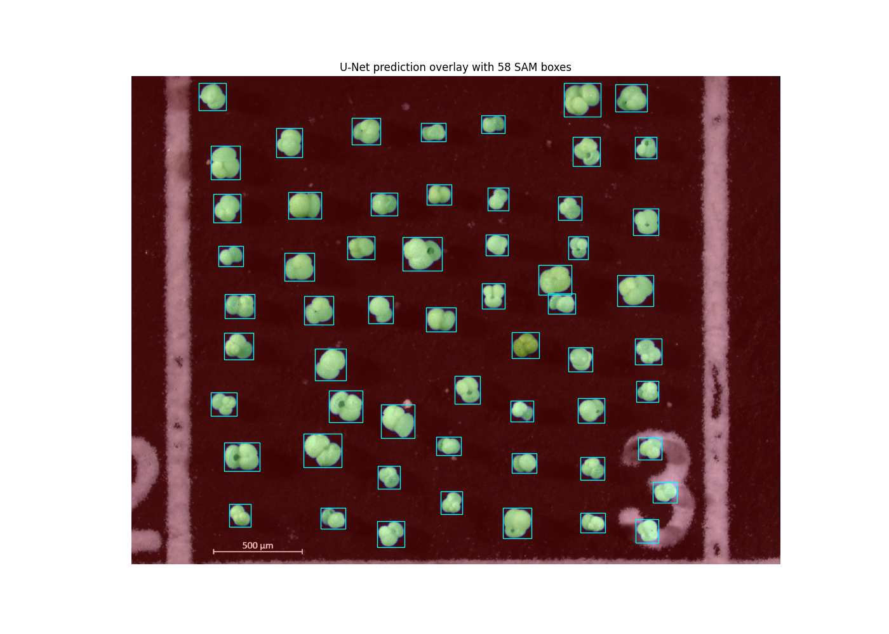
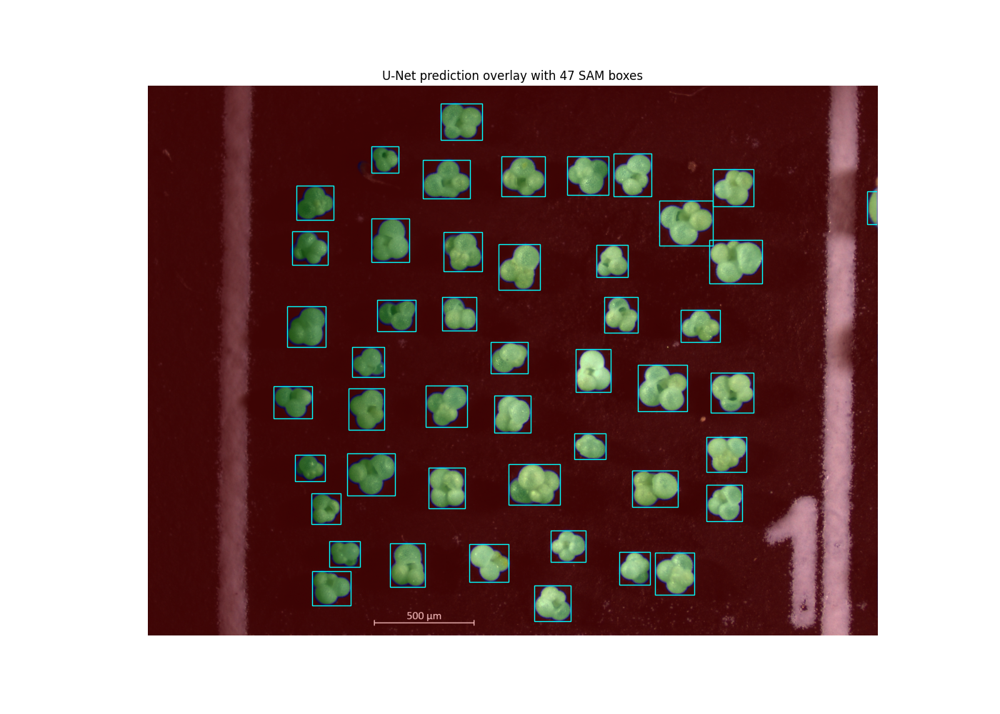
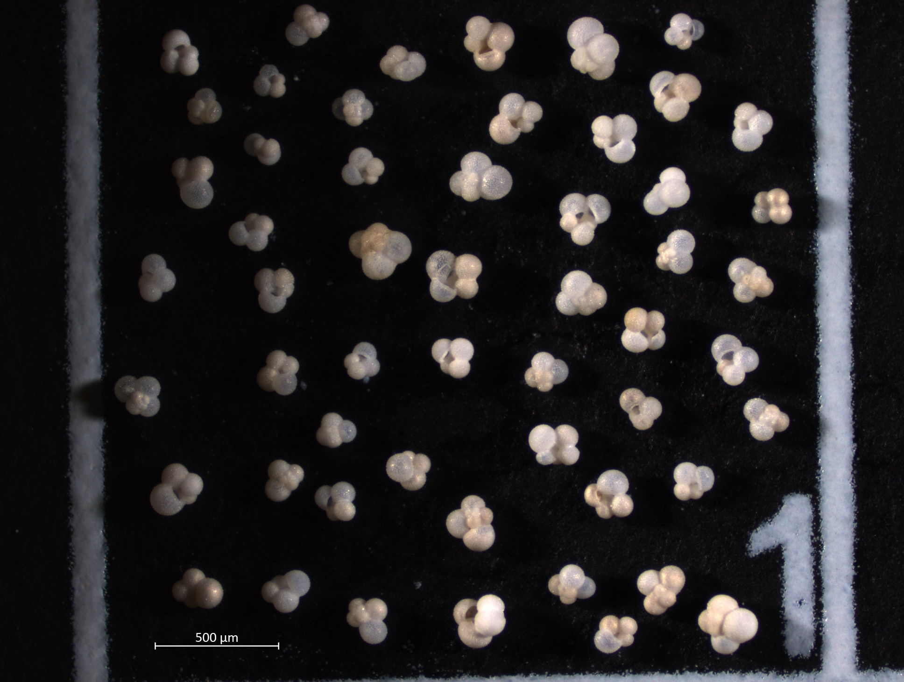
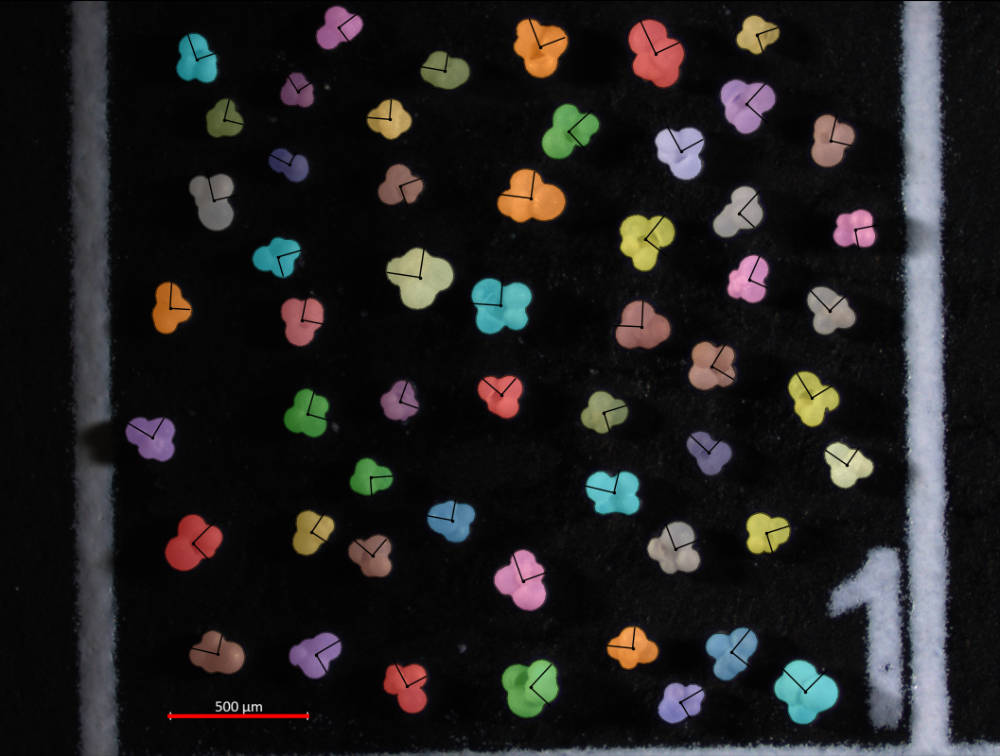
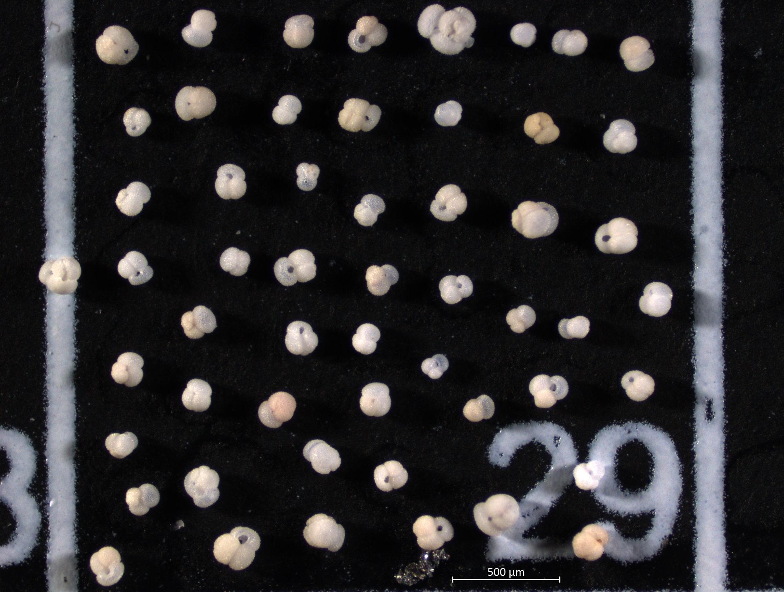
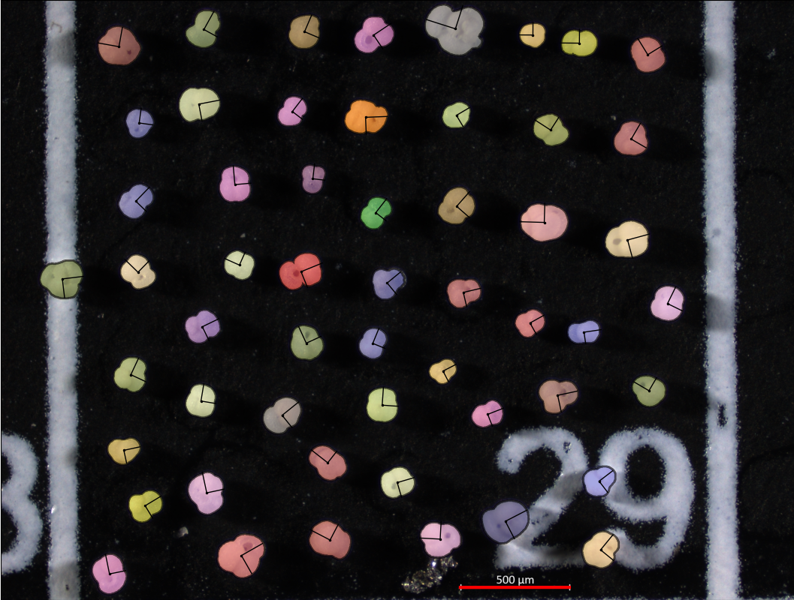

# SegmentEveryForam

<p align="center">
  
  
</p>

<p align="center">
  <em>Automated segmentation, interactive correction, and morphometric analysis of foraminifera from microscope images.</em>
</p>

**SegmentEveryForam** is a Python package for automated segmentation, interactive correction, and image-based morphometric analysis of foraminifera. It finds every test in a microscope image with a U-Net fine-tuned on foraminifera, refines each outline with SAM 2.1, and measures size and shape for every specimen, producing per-sample and per-species summaries.

It is built on [Segmenteverygrain](https://github.com/zsylvester/segmenteverygrain) (Sylvester et al., 2025).

> **Development status:** SegmentEveryForam is currently under active development.

## Choose a workflow

| Workflow | Interface | Where the models run |
| --- | --- | --- |
| [Local Jupyter notebook](notebooks/SegmentEveryForam_workflow.ipynb) | Notebook cells and the interactive `ForamPlot` editor | Your computer |
| [Google Colab notebook](https://colab.research.google.com/github/Geogabriel/SegmentEveryForam/blob/main/notebooks/SegmentEveryForam_colab.ipynb) | Notebook cells in your browser | A Colab GPU runtime |
| [Gradio web app prototype](#try-it-in-colab) | A dedicated page for uploads, mask edits, calibration, and exports | A Colab GPU runtime or a GPU workstation |

The Jupyter workflow is covered in [Installation](#installation). For the Colab notebook, select **Runtime → Change runtime type → GPU**, then follow the notebook from the top.

## Overview

SegmentEveryForam uses a two-stage segmentation workflow:

1. A U-Net model generates an initial semantic segmentation of the image.
2. The initial segmentation is used to generate prompts for SAM 2.1, which produces individual object masks.

The resulting segmentations can then be inspected and manually corrected using the interactive `ForamPlot` interface.

The general workflow is:

```text
Microscope image
      |
      v
U-Net segmentation
      |
      v
SAM prompt generation
      |
      v
SAM 2.1 instance segmentation
      |
      v
Interactive correction
      |
      v
Foraminifera masks and measurements
```
## Segmentation examples

<p align="center">
  
  
</p>

<p align="center">
  <em>Globigerina bulloides</em>: original microscope image (left) and SegmentEveryForam segmentation output (right).
</p>

<p align="center">
  
  
</p>

<p align="center">
  <em>Globigerinoides ruber</em>: original microscope image (left) and SegmentEveryForam segmentation output (right).
</p>

## Current features

SegmentEveryForam currently provides tools for:

- U-Net-based semantic segmentation
- SAM 2.1-based instance segmentation
- Interactive correction of segmentation results
- Manual creation of missed foraminifera using SAM prompts
- Deletion of incorrectly segmented objects
- Addition and merging of touching foram segments
- Scale calibration
- Extraction of segmentation masks and object measurements

Additional foraminifera-specific functionality is under development.

## Requirements

The current tested SegmentEveryForam environment uses **Python 3.10**.

Major dependencies include:

- TensorFlow
- Keras
- PyTorch
- SAM 2
- NumPy
- Pandas
- Matplotlib
- scikit-image
- scikit-learn
- OpenCV
- Shapely
- Rasterio

The recommended installation method uses the Conda environment provided with the repository.

## Installation

For complete Windows installation instructions using Anaconda Prompt, see the **[Installation Guide](INSTALLATION.md)**.

### Quick Start

For users who already have Conda and Git installed:

```bash
git clone https://github.com/Geogabriel/SegmentEveryForam.git
cd SegmentEveryForam
conda env create -f environment.yml
conda activate segmenteveryforam
jupyter lab
```

The `environment.yml` file is included when the repository is cloned. It does not need to be downloaded separately.

After JupyterLab opens, navigate to:

```text
notebooks/SegmentEveryForam_workflow.ipynb
```

and run the workflow from the top downward.

SegmentEveryForam can be imported using:

```python
import segmenteveryforam as sef
```

The interactive module can be imported using:

```python
import segmenteveryforam.interactions as sfi
```

## Browser prototype

The browser interface runs one image at a time on a machine with a CUDA GPU. It uses the same fine-tuned U-Net, SAM 2.1 Large, and specimen export workflow as the Colab notebook.

### Try it in Colab

Start a fresh Colab notebook and select **Runtime → Change runtime type → GPU**. Run this installation cell:

```python
%pip -q install 'gradio>=5.49,<6' rtree rasterio
%env SAM2_BUILD_CUDA=0
%pip -q install --no-build-isolation 'git+https://github.com/facebookresearch/sam2.git'
!git clone https://github.com/Geogabriel/SegmentEveryForam.git
%cd SegmentEveryForam
```

Run the launch cell below and open the Gradio link it prints. Sign in as `sef` with the password you enter at launch. The app asks for a password each time you launch it. You can reuse one or choose a new one.

```python
from getpass import getpass
from web_app import build_app

password = getpass('Create a password for this demo: ')
if not password.strip():
    raise ValueError('Enter a password before opening the demo link.')
build_app().launch(share=True, auth=('sef', password), max_file_size='50mb')
```

You can reopen the same URL while the app and Colab runtime are active. The demo link expires after one week and may stop working sooner if the runtime shuts down. A fresh launch generates a new URL. If the app stopped and the same runtime still has the dependencies and checkout, rerun the launch cell. For a fresh runtime, run both cells.

### Run on a GPU workstation

From the repository root, with the SegmentEveryForam environment activated and CUDA-enabled PyTorch installed, run:

```bash
python -m pip install 'gradio>=5.49,<6'
python web_app.py
```

Open the local URL printed in the terminal. This launch listens on localhost.

Upload a PNG, JPEG, or TIFF and select **Run segmentation**. The first run downloads both model checkpoints. To edit the numbered overlay, select a review tool, then click a mask to remove it or click a missed specimen to add it. For calibration, click both ends of the scale bar and enter its printed length in micrometers, or enter a known calibration in pixels per meter. Download the ZIP after exporting.

## Models

SegmentEveryForam combines U-Net-based semantic segmentation with SAM 2.1-based instance segmentation.

The repository includes two U-Net checkpoints, produced in two fine-tuning stages. Both predict three classes: background, foraminiferal test interior and external boundary.

| | Stage 1: `seg_model_foram_v1_30epochs.keras` | Stage 2: `best_val_loss.keras` (default) |
| --- | --- | --- |
| Starting weights | Segmenteverygrain `seg_model_smooth_labels.keras` | Stage 1 checkpoint |
| Training data | 51 image–mask pairs from several taxa, including *G. bulloides* and *G. ruber* | 40 *Globigerinoides ruber* image–mask pairs |
| Split | Random split of 7,140 patches (256 × 256, stride 128) | By original image before patching: 28 train, 6 validation, 6 test |
| Epochs | 30 | 100; the checkpoint with the lowest validation loss is kept |
| Notebook | [`Train_foram_unet_v1.ipynb`](notebooks/Train_foram_unet_v1.ipynb) | [`SEF_v2_100epochs.ipynb`](notebooks/SEF_v2_100epochs.ipynb) |

Stage 1 reported a mean IoU of 0.898 and a boundary-class IoU of 0.744 on its held-out patches. Because that split was made at the patch level, the test patches come from the same microscope images as the training patches, so these figures are likely optimistic. Stage 2 splits by image to avoid this.

### Evaluation

[`Evaluate_saved_UNet_checkpoints.ipynb`](notebooks/Evaluate_saved_UNet_checkpoints.ipynb) compares both checkpoints on the same three held-out *G. ruber* reference image–mask pairs. It scores the U-Net prediction alone, before SAM, on 256 × 256 patches with stride 128, and pools the confusion matrix across all patches. Intersection over union (IoU) is shown per class.

| Checkpoint | Mean IoU | Background | Test interior | Boundary | Pixel accuracy |
| --- | --- | --- | --- | --- | --- |
| Stage 1 (`seg_model_foram_v1_30epochs.keras`) | 0.921 | 0.996 | 0.973 | 0.794 | 0.994 |
| Stage 2 (`best_val_loss.keras`) | **0.925** | **0.997** | **0.975** | **0.804** | 0.994 |

Stage 2 scores higher on every class, and its boundary IoU is higher on each of the three images (0.806 vs 0.793, 0.795 vs 0.786 and 0.810 vs 0.804). The gains are small, and three images are too few to treat them as a firm ranking. Boundary IoU is the most informative column, because the outline is what determines the SAM prompts and the morphometric measurements.

None of the three reference images was used to train, validate or test either checkpoint. They were kept in a separate folder throughout.

Per-image results and the evaluation protocol are in [`models/evaluation/`](models/evaluation/).

### SAM 2.1

SegmentEveryForam uses SAM 2.1 for instance segmentation and interactive refinement.

SAM 2.1 model checkpoints are developed and distributed by Meta and are **not included in this repository**. Users must obtain the required SAM 2.1 checkpoint separately before running the SAM-based segmentation workflow.

The current workflow uses:

```text
sam2.1_hiera_large.pt
```

and expects the checkpoint to be placed in:

```text
models/sam2.1_hiera_large.pt
```

After setup, the `models/` directory should therefore contain:

```text
models/
├── best_val_loss.keras
├── seg_model_foram_v1_30epochs.keras
└── sam2.1_hiera_large.pt
```

See the [Installation Guide](INSTALLATION.md) for setup instructions and `models/README.md` for additional information about model provenance and usage.

## Interactive editing

SegmentEveryForam provides the `ForamPlot` interactive interface for inspecting and correcting segmentation results.

A typical interface can be created with:

```python
plot = sfi.ForamPlot(
    forams,
    image=image,
    predictor=predictor
)

plot.activate()
```

Current interactive controls include:

- **Left click on an existing foram:** Select or unselect the segmentation
- **Left click in an unsegmented area:** Create a foram using a SAM foreground prompt
- **Alt + Left click:** Add a foreground SAM prompt
- **Alt + Right click:** Add a background SAM prompt
- **C:** Create a foram from existing SAM prompts
- **D:** Delete selected foram segmentations
- **A:** Add or merge selected touching foram segments
- **M:** Legacy shortcut for merging selected segments
- **Z:** Remove the most recently created segmentation
- **H:** Toggle the coverage mask
- **Esc:** Clear selections and prompts
- **Ctrl (hold):** Temporarily hide selected masks
- **Shift + drag:** Draw a scale bar for unit conversion

`GrainPlot` remains available as a backward-compatible alias for code originally written for Segmenteverygrain.

## Morphometric analysis

Following segmentation, interactive correction, and scale calibration, SegmentEveryForam can extract specimen-level morphometric measurements from individual foraminifera.

Current measurements include:

- area
- perimeter
- major diameter
- minor diameter
- equivalent diameter
- aspect ratio
- elongation
- roundness
- circularity
- perimeter-to-area ratio
- orientation
- centroid coordinates

Measurements can be converted from pixels to physical units using image-scale calibration.

SegmentEveryForam can save specimen-level morphometric data for individual samples and generate summary statistics including the mean, median, standard deviation, percentiles, and interquartile range.

When multiple samples of the same species have been processed, specimen-level data can also be combined across samples for subsequent visualization and analysis.

## Acknowledgements

SegmentEveryForam's U-Net and SAM workflow, image-processing utilities and interactive editor build on [Segmenteverygrain](https://github.com/zsylvester/segmenteverygrain) by Zoltán Sylvester and collaborators. The original `interactions` module was written by Dave Matthews. See the Segmenteverygrain repository for its full acknowledgements.

## Citation

If you use SegmentEveryForam, please cite the software. Citation metadata is in [`CITATION.cff`](CITATION.cff), and GitHub's **Cite this repository** button generates APA and BibTeX from it.

<!-- ZENODO: add the DOI badge and concept DOI here after the first archived release. -->

Please also cite the Segmenteverygrain paper, on which SegmentEveryForam builds:

Sylvester, Z., Stockli, D. F., Howes, N., Roberts, K., Malkowski, M. A., Poros, Z., Martindale, R. C., & Bai, W. (2025). Segmenteverygrain: A Python module for segmentation of grains in images. *Journal of Open Source Software*, 10(112), 7953. https://doi.org/10.21105/joss.07953

```bibtex
@article{Sylvester2025,
  doi = {10.21105/joss.07953},
  url = {https://doi.org/10.21105/joss.07953},
  year = {2025},
  publisher = {The Open Journal},
  volume = {10},
  number = {112},
  pages = {7953},
  author = {Sylvester, Zoltán and Stockli, Daniel F. and Howes, Nick and Roberts, Kalinda and Malkowski, Matthew A. and Poros, Zsófia and Martindale, Rowan C. and Bai, Wilson},
  title = {Segmenteverygrain: A Python module for segmentation of grains in images},
  journal = {Journal of Open Source Software}
}
```

## License

SegmentEveryForam is distributed under the Apache License 2.0. See [`LICENSE.txt`](LICENSE.txt) for the full license text and [`NOTICE`](NOTICE) for attribution and a summary of changes from Segmenteverygrain.